# ★ Oficina Virtual

**Una oficina 8-bit para dirigir un equipo de agentes de IA de código — Claude Code, Codex, Antigravity y CommandCode — desde el navegador.**

Le asignas tareas a cada agente por proyecto y área, los ves trabajar en tiempo real en un mapa estilo *Gather*, respondes sus preguntas, revisas el diff y fusionas su rama. Si un agente se queda sin cuota, otro toma el relevo con todo el contexto y no se pierde nada.

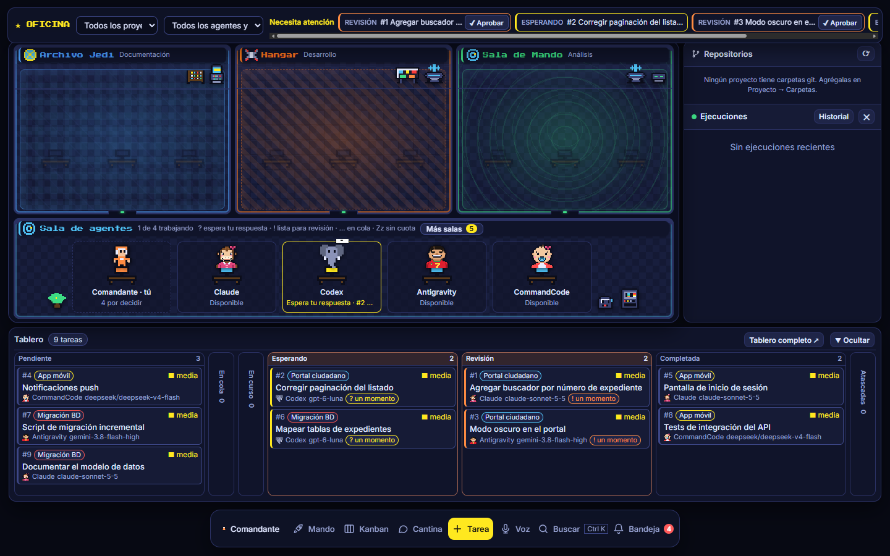

- **Sin dependencias npm.** Node 22+ (`node:sqlite`), HTML/CSS/JS sin build.
- **Usa los CLIs que ya tienes** (`claude`, `codex`, `agy`, `commandcode`) con tu propia sesión y suscripción: no hay API keys de por medio.
- **Agentes en paralelo sin pisarse:** cada tarea corre en su propio `git worktree`.
- **Accesible desde cualquier lado:** servidor en un VPS y tu PC como ejecutora, conectada por una conexión saliente (sin abrir puertos).
- **Control remoto de tu PC desde el celular:** con **Mando Directo** ves la pantalla de tu PC, haces clic, escribes, ejecutas PowerShell y le hablas a los agentes por voz, todo desde el navegador.

---

## 🚀 Mando Directo: tu PC en el bolsillo

**Mando Directo** es el centro de control de la oficina. Desde el celular o cualquier navegador manejas tus proyectos, tus 4 agentes y **tu PC Windows completa**, aunque estés lejos de ella.

<p align="center">
  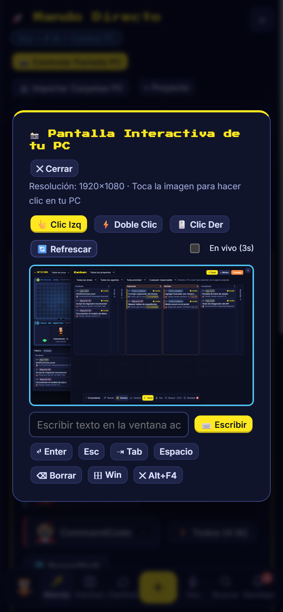
  &nbsp;&nbsp;
  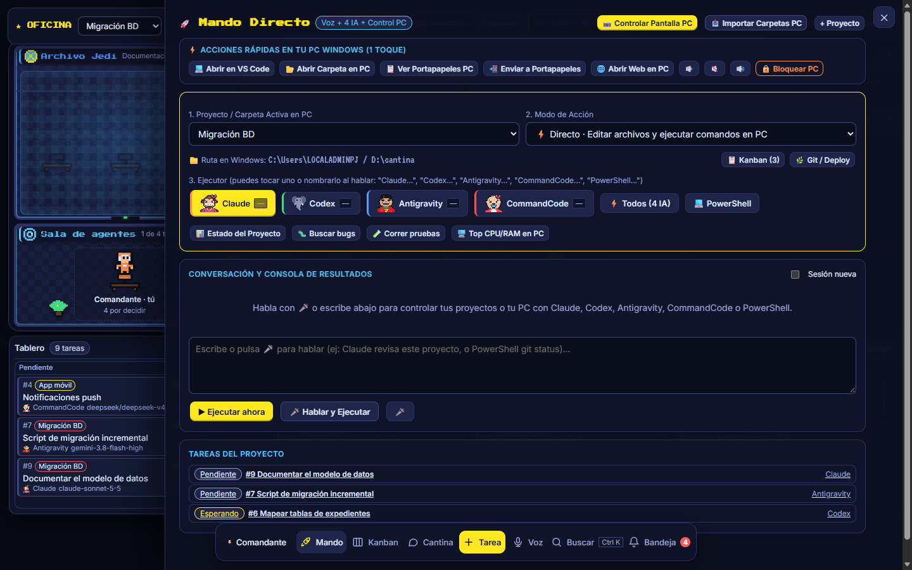
</p>

| Qué puedes hacer | Cómo |
|---|---|
| 🖥️ **Ver y manejar la pantalla de tu PC** | **Controlar Pantalla PC** abre una captura en vivo de tu escritorio. Tocas cualquier punto y la PC hace **clic izquierdo, doble clic o clic derecho** ahí. Puedes refrescar a mano o activar **En vivo** (cada 3 s). |
| ⌨️ **Escribir en la PC** | Envía texto a la ventana activa y teclas especiales: Enter, Esc, Tab, Espacio, Borrar, Win y Alt+F4. Cada acción te devuelve la pantalla actualizada. |
| 🤖 **Darle órdenes a los agentes** | Elige Claude, Codex, Antigravity o CommandCode, o **⚡ Todos (4 IA)** para lanzar los cuatro en paralelo sobre el proyecto y comparar respuestas. La conversación sigue el hilo de la anterior; marca *Sesión nueva* para empezar de cero. |
| 💻 **Ejecutar PowerShell** | Corre comandos en la carpeta del proyecto (`git status`, `npm test`, …) y ve la salida en la misma consola. |
| 🎤 **Mandar por voz** | Pulsa el micrófono y di, por ejemplo, *"Claude, revisa este proyecto"*, *"todos, propongan mejoras"*, *"PowerShell git status"* o *"proyecto Portal, Codex, corre las pruebas"*. Reconoce el agente, el proyecto y si es un comando de consola. |
| ⚙️ **Elegir el modo** | *Directo · Editar* (edita archivos y ejecuta comandos), *Directo · Solo lectura* (análisis) o *Crear tarea* (tarea de prioridad alta en su propio worktree git, que arranca al instante). |
| ⚡ **Acciones rápidas de un toque** | Abrir el proyecto en **VS Code** o en el **Explorador**, **ver o enviar el portapapeles** de la PC, **abrir una web** en la PC, **subir, bajar o silenciar el volumen** y **bloquear la sesión de Windows**. |
| 🧭 **Atajos del proyecto** | Estado del proyecto, buscar bugs, correr pruebas, ver qué consume CPU/RAM; saltar al Kanban o a Git/Deploy; ver las tareas del proyecto. |
| 📥 **Importar carpetas de la PC** | Recorre las carpetas de tu PC, marca las que quieras (las que son repos git aparecen primero) y se crean como proyectos listos para usar. |

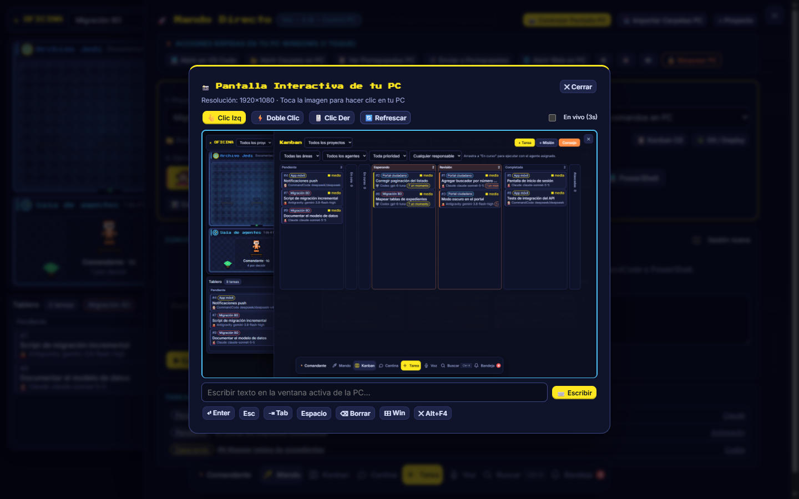

<sub>La pantalla que aparece dentro del control es una imagen de demostración.</sub>

**Cómo funciona por dentro:** la web llama a la API `/api/mando/*` del servidor, que reenvía la orden a la PC por la misma conexión saliente del [agente de campo](#4-agente-de-campo-en-la-pc). En la PC, [`hostops.js`](hostops.js) toma la captura con .NET (`System.Drawing`), mueve el mouse y hace clic con `user32.dll`, escribe con `SendKeys` y ejecuta PowerShell solo dentro de las carpetas permitidas en `roots`. No hace falta abrir puertos ni instalar nada extra: si el agente de campo está conectado, el Mando funciona.

> [!CAUTION]
> El Mando da control total de la PC (pantalla, teclado, PowerShell). Solo los roles `operador` y `admin` pueden usarlo. Si la oficina está expuesta a internet, protégela con HTTPS y `OFICINA_AUTH=google`.

---

## Índice

- [Mando Directo: tu PC en el bolsillo](#-mando-directo-tu-pc-en-el-bolsillo)
- [Capturas](#capturas)
- [Inicio rápido](#inicio-rápido)
- [Cómo funciona](#cómo-funciona)
- [Secciones](#secciones)
- [Despliegue en un VPS con la PC como ejecutora](#despliegue-en-un-vps-con-la-pc-como-ejecutora)
- [Extras opcionales](#extras-opcionales)
- [Datos y variables de entorno](#datos-y-variables-de-entorno)
- [Seguridad](#seguridad)
- [Pruebas](#pruebas)
- [Estructura del código](#estructura-del-código)

---

## Capturas

| | |
|---|---|
| **Kanban** — arrastra a *En curso* para ejecutar con el agente asignado 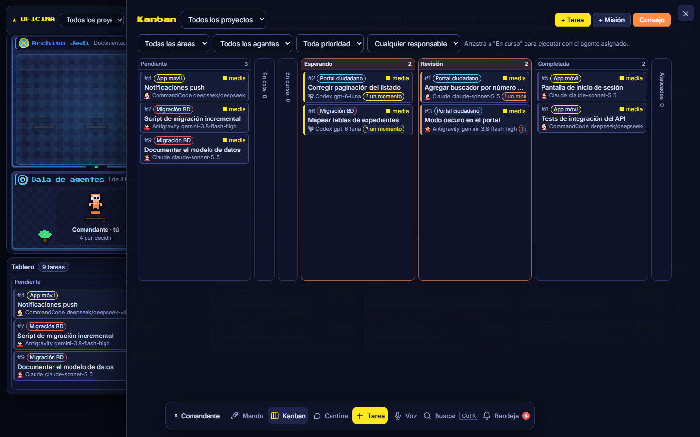 | **Tarea** — consola en vivo, chat, diff, ejecuciones, relevos e historial 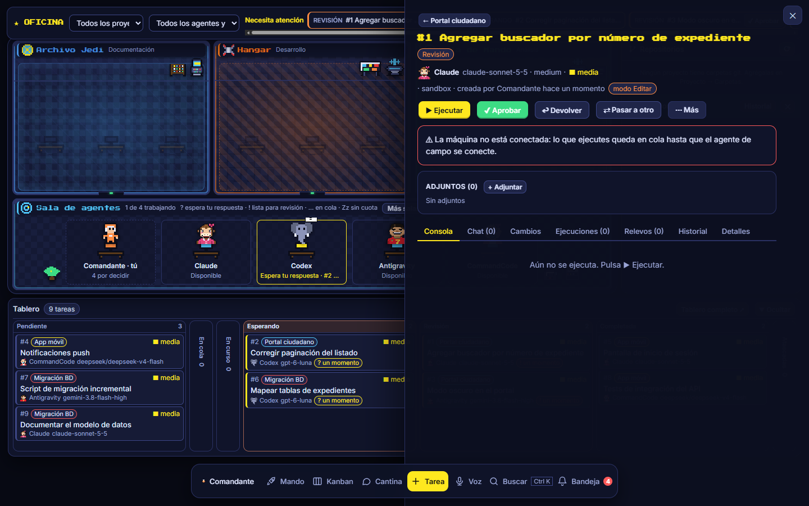 |
| **Cantina** — consultas rápidas sin crear tarea 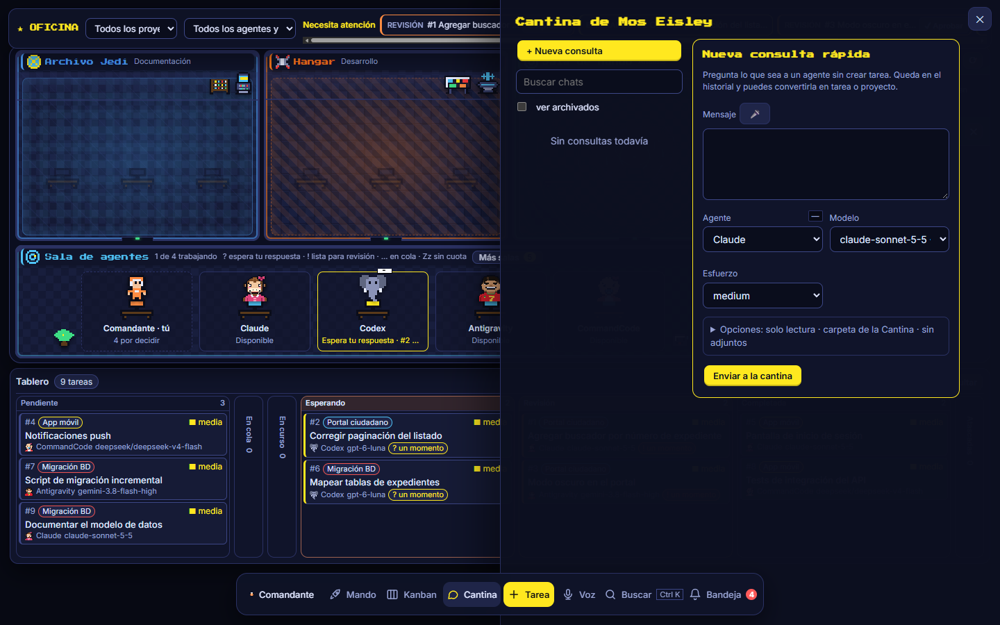 | **Mando Directo** — los 4 agentes + PowerShell, por texto o voz  |
| **Puente de Mando** — salud, versión, cuota y consumo de cada agente 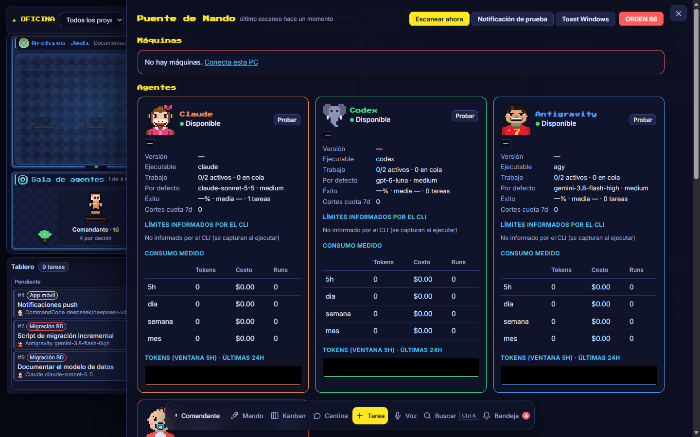 | **Configuración** — máquinas, agentes, áreas, usuarios, límites 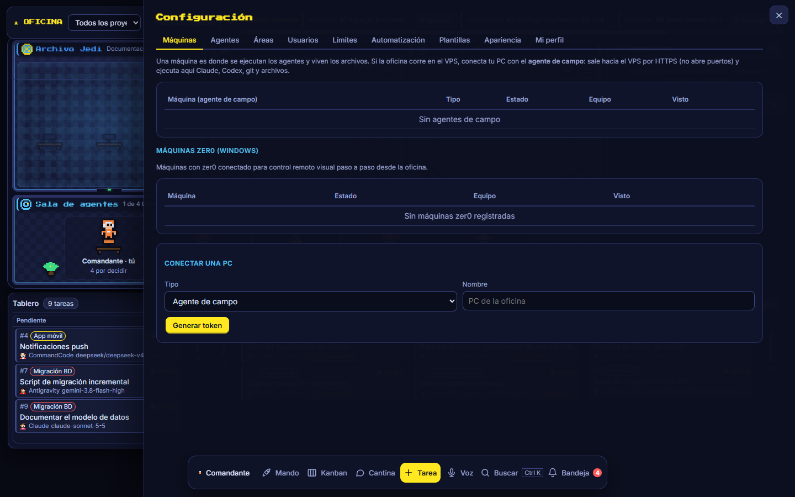 |
| **Consejo Jedi** — los agentes proponen mejoras sobre lo hecho 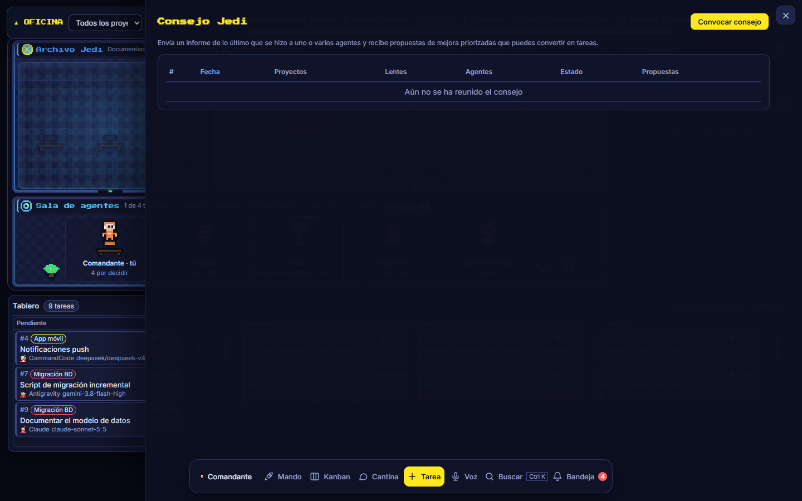 | **Archivos Jedi** — historial completo con búsqueda y CSV 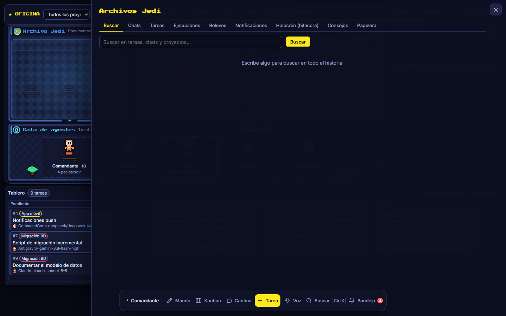 |

<sub>Capturas tomadas con datos de demostración.</sub>

---

## Inicio rápido

Requisitos: **Node 22+**, **git** y al menos uno de los CLIs instalado y con sesión iniciada: `claude`, `codex`, `agy` o `commandcode`.

```bash
git clone https://github.com/lhmr0/oficina-virtual.git
cd oficina-virtual
node --no-warnings server.js
```

En Windows también sirve doble clic en `iniciar.bat`.

Abre <http://127.0.0.1:4242>. El primer ingreso crea al **Comandante** (administrador). Luego:

1. **Proyectos → Nuevo**: dale un nombre y una o varias carpetas locales (git opcional).
2. **+ Tarea**: título, instrucciones, agente, modelo, esfuerzo y modo (*Plan*, *Editar* o *Supervisado*).
3. Pulsa **Ejecutar** (o arrastra la tarjeta a *En curso* en el Kanban) y mira la consola en vivo.
4. Cuando el agente termina, la tarea pasa a **Revisión**: revisa el diff y **Aprueba** (puedes fusionar la rama) o **Devuelve** con un comentario.

---

## Cómo funciona

```
 Navegador ──► server.js (HTTP + SSE, SQLite)
                   │
                   ├─ runner.js ──► lanza el CLI del agente en la carpeta de la tarea
                   │                 (claude / codex / agy / commandcode)
                   │                 y transmite su salida en vivo
                   │
                   └─ worker.js (opcional, en otra PC) ──► igual, pero remoto,
                                     por conexión saliente HTTPS
```

**Ciclo de una tarea**

1. **Aislamiento.** Si la carpeta es un repo git, la tarea corre en su propio **worktree** (`<repo>/.oficina-worktrees/task-N`, rama `oficina/task-N-…`), así varios agentes trabajan en paralelo en el mismo repo. Sin git, corre en la carpeta (una tarea a la vez). Sin carpeta, en `data/sandbox/task-N`.
2. **Protocolo.** El agente mantiene `.oficina/progreso.md` y termina cada turno con `[[CONSULTA]]` (te pregunta algo → notificación) o `[[LISTO]]` (pasa a *Revisión*).
3. **Conversación.** Al responder se **reanuda la misma sesión** del CLI, con todo su contexto.
4. **Integración.** El agente **no** hace push ni despliega desde su rama. Eso se hace en el panel **Repositorios**: ves cada repo con su rama base (↑/↓ respecto al remoto, cambios sin commit), las ramas de tareas pendientes (commits, archivos, si chocan con la base o con otra tarea), y botones de **Aprobar y fusionar**, **Push** (`pull --no-rebase` + push: nunca pisa lo remoto; si hay conflicto crea una tarea para resolverlo) y **Desplegar**. El comando de despliegue se define por repo en `worker.json`: `"deploy": { "C:\\ruta\\repo": "bash C:/ruta/deploy.sh" }`.
5. **Relevo.** Si se agota la cuota del agente: checkpoint git + *snapshot* de relevo, y eliges quién continúa (o se hace solo, según la cadena de relevo del área).
6. **Supervisión.** En modo *Supervisado* (Claude), cada permiso que pide el agente aparece en vivo para aprobarlo o denegarlo.

**Modos de ejecución**

| Modo | Qué puede hacer el agente |
|---|---|
| **Plan** | Solo lectura. |
| **Supervisado** (Claude) | Te pide cada permiso en la web. |
| **Editar** | Trabaja sin pedir permiso y sin sandbox (ver [Seguridad](#seguridad)). |

---

## Secciones

| Sección | Para qué |
|---|---|
| **Estación** | Mapa de la oficina: cada área (Documentación, Desarrollo, Análisis…) es una sala con escritorios donde se trabajan sus tareas. En la **Sala de agentes** cada agente tiene su puesto con lo que hace, en qué tarea y su cuota (`?` espera tu respuesta, `!` lista para revisión, `Zz` sin cuota). Todo lo demás se abre en un panel lateral sobre el mapa; dock inferior y buscador **Ctrl+K**. |
| **Proyectos** | Con carpetas locales (una o varias, git opcional) o solo de registro. Estado, avance, métricas. |
| **Kanban** | Por proyecto o global. Filtros por área, agente, prioridad y responsable. Arrastra a *En curso* para ejecutar. |
| **Tarea** | Agente + modelo + esfuerzo + modo, consola en vivo, chat con el agente, adjuntos, diff, ejecuciones, relevos e historial de cambios. |
| **Cantina** | Consultas rápidas sin proyecto; multi-turno, cambio de agente a mitad de la conversación, y convertir el chat en tarea o proyecto. |
| **Mando Directo** | Control remoto de la PC y de los agentes desde el celular: pantalla en vivo con clic y teclado, los 4 agentes (o todos a la vez), PowerShell, voz, acciones rápidas e importar carpetas. Ver [Mando Directo](#-mando-directo-tu-pc-en-el-bolsillo). |
| **Consejo Jedi** | Informe de lo hecho → uno o varios agentes proponen mejoras desde distintas "lentes" → tablero de propuestas → tareas. |
| **Archivos Jedi** | Historial de chats, tareas, ejecuciones, relevos, notificaciones, bitácora, consejos y papelera. Búsqueda global y exportación CSV. |
| **Puente de Mando** | Estado de todo: versión y salud de cada agente, límites (los que informa el CLI + medidos + manuales), consumo en tokens y USD, procesos, carpetas git, sistema. |
| **Configuración** | Máquinas, agentes (comando, modelos, **precios por modelo** en USD/1M tokens, esfuerzos, concurrencia, patrones de cuota), áreas y cadena de relevo, usuarios y roles (`admin`, `operador`, `observador`), límites, automatización, plantillas, apariencia y perfil. |

---

## Despliegue en un VPS con la PC como ejecutora

```
Celular / laptop ──HTTPS──► VPS (web, BD, login Google, cola)
                                  ▲
                    conexión SALIENTE HTTPS (sin abrir puertos)
                                  │
                     PC ── worker.js (agente de campo): CLIs de los agentes, git, archivos
```

- Si la PC está apagada, las tareas quedan **en cola** y arrancan solas cuando el agente de campo se reconecta.
- El agente de campo solo lanza `claude`, `codex`, `agy` y CommandCode, y solo trabaja en carpetas dentro de `roots` (`worker.json`).
- Los adjuntos se suben al VPS y el agente de campo los baja a `.oficina/adjuntos/` antes del turno.

En los pasos siguientes, reemplaza `tu-dominio.com` por tu dominio.

### 1. Login con Google (una vez)

1. En <https://console.cloud.google.com> crea un proyecto.
2. **Google Auth Platform → Branding / Audiencia**: tipo **Externo**, estado **Prueba**; en *Usuarios de prueba* agrega los correos permitidos.
3. **Clientes → Crear cliente → Aplicación web**
   - Orígenes autorizados: `https://tu-dominio.com`
   - URI de redirección: `https://tu-dominio.com/api/auth/google/callback`
4. Guarda el ID y el secreto **directamente** en el VPS, en `~/oficina/.env` (permisos `600`):

```ini
OFICINA_AUTH=google
OFICINA_PUBLIC_URL=https://tu-dominio.com
OFICINA_ALLOWED_EMAILS=correo1@ejemplo.com,correo2@ejemplo.com
GOOGLE_CLIENT_ID=
GOOGLE_CLIENT_SECRET=
```

Solo entran los correos de `OFICINA_ALLOWED_EMAILS` (verificados por Google); en este modo no existe login por contraseña.

### 2. Proxy inverso

El contenedor escucha en `127.0.0.1:4242`. Pon delante Apache o Nginx con HTTPS. Hay un ejemplo de Apache en [`deploy/ua.csjla.pe-le-ssl.conf`](deploy/ua.csjla.pe-le-ssl.conf) (incluye la configuración para SSE).

### 3. Desplegar / actualizar

Con Docker ([`Dockerfile`](Dockerfile)). Desde la PC, el script sube el último commit, reconstruye y reinicia el contenedor `oficina-virtual`:

```bash
bash deploy/deploy-vps.sh
```

### 4. Agente de campo en la PC

- Token: **Configuración → Máquinas → Generar token**, o en el VPS:
  `docker run --rm -v ~/oficina/data:/data oficina-virtual node server.js crear-maquina "PC"`
- Crea `worker.json` junto a `worker.js` (está en `.gitignore`):
  ```json
  { "url": "https://tu-dominio.com", "token": "…", "roots": ["C:\\Users\\TU_USUARIO"] }
  ```
- Probar: `node worker.js`
- Dejarlo siempre activo (Windows, tarea al iniciar sesión, log en `worker.log`):
  ```powershell
  powershell -ExecutionPolicy Bypass -File instalar-agente.ps1
  ```
- La PC no debe suspenderse si quieres trabajar desde fuera.

### 5. Actualización diaria de CLIs y modelos

[`actualizar-diario.ps1`](actualizar-diario.ps1) actualiza los 4 CLIs y sincroniza sus modelos y esfuerzos de razonamiento en la base de datos (log en `actualizar.log`).

```powershell
# Ejecutar ahora (o doble clic en actualizar-diario.bat)
powershell -ExecutionPolicy Bypass -File .\actualizar-diario.ps1
# Programar todos los días a las 03:00
powershell -ExecutionPolicy Bypass -File .\actualizar-diario.ps1 -InstalarTarea -Hora "03:00"
# Quitar la tarea programada
powershell -ExecutionPolicy Bypass -File .\actualizar-diario.ps1 -DesinstalarTarea
```

---

## Extras opcionales

### Servicio de IA local: voz y adjuntos → texto

Contenedor `oficina-ia` ([`deploy/ia/`](deploy/ia/)) para un servidor de la red interna, sin GPU:

- **🎤 Dictado** en la Cantina, las respuestas y la tarea nueva (Whisper `large-v3-turbo`, español). Al agente se le avisa que el texto viene de un dictado. **🔊** lee en voz alta las respuestas.
- **🎤 Órdenes por voz** desde el dock: crea tareas (proyecto, título, agente y área), lanza consultas a la Cantina, navega y busca en el historial. La orden se interpreta con reglas ([`public/ordenes.js`](public/ordenes.js)) y se confirma en pantalla antes de ejecutarse.
- **Adjuntos PDF/Office → `<adjunto>.md`** (tablas incluidas; OCR en español para escaneados), que el agente lee en vez del original.

Instalar: copia `deploy/ia` al servidor, crea `secrets/api_key` y ejecuta `docker compose up -d --build`. En la oficina define `OFICINA_IA_URL=http://<servidor>:8010` y `OFICINA_IA_KEY=<clave>`. Sin estas variables la función queda apagada; si el servicio cae, todo lo demás sigue funcionando.

### Control del PC con zer0 (Windows)

Una PC con **zer0** puede registrarse como máquina de tipo `zer0` (**Configuración → Máquinas → Tipo «zer0 (Windows)»**) para control visual paso a paso desde la vista `#/pc`. Usa el mismo protocolo saliente que el agente de campo, pero **no ejecuta tareas ni agentes** y su token solo puede usar sus propias rutas.

- La aprobación de cada acción es local en zer0; la web solo puede aprobar si el interruptor local «Permitir aprobar acciones desde oficina» está activo.
- Los pantallazos viven **solo en memoria** (máx. 20 por PC, ≤ 400 KB, solo admin, `Cache-Control: no-store`) y se borran a los `OFICINA_PC_FRAME_TTL_MS` (10 min) de terminar la sesión; una sesión sin respuesta vence a los `OFICINA_PC_SESSION_MAX_MS` (11 min).
- API: `GET /api/pc` (observador), `GET /api/pc/:id/status` y `POST /api/pc/:id/stop` (operador), `POST /api/pc/:id/ask`, `POST|GET /api/pc/:id/session`, `GET /api/pc/:id/frame/:frameId` y `POST /api/pc/:id/approve` (admin).

---

## Datos y variables de entorno

Todo vive en `data/`: SQLite `oficina.db`, logs de ejecución, sandbox y respaldos diarios.

| Variable | Por defecto | Para qué |
|---|---|---|
| `OFICINA_PORT` | `4242` | Puerto HTTP. |
| `OFICINA_BIND` | `127.0.0.1` | Interfaz de escucha. |
| `OFICINA_DATA` | `./data` | Carpeta de datos. |
| `OFICINA_LOCAL_EXEC` | `1` | `0` = no ejecutar agentes en el servidor (solo vía agente de campo). |
| `OFICINA_AUTH` | `password` | `password` o `google`. |
| `OFICINA_PUBLIC_URL` | | URL pública (necesaria para Google). |
| `OFICINA_ALLOWED_EMAILS` | | Correos permitidos con Google, separados por coma. |
| `GOOGLE_CLIENT_ID` / `GOOGLE_CLIENT_SECRET` | | Credenciales OAuth de Google. |
| `OFICINA_CANTINA` | | Carpeta fija de trabajo de la Cantina (vacío = sandbox por chat). |
| `OFICINA_IA_URL` / `OFICINA_IA_KEY` | | Servicio de IA local (voz y adjuntos). |
| `OFICINA_NO_TOAST` | | Desactiva las notificaciones nativas de Windows. |

---

## Seguridad

> [!WARNING]
> En modo **Editar** los agentes trabajan **sin pedir permiso y sin sandbox** (Claude `bypassPermissions`, Codex `--dangerously-bypass-approvals-and-sandbox`, agy `--dangerously-skip-permissions`, CommandCode `auto-accept`): pueden ejecutar comandos, hacer push y desplegar con tus credenciales, igual que tu CLI. Usa *Plan* o *Supervisado* si no confías en la tarea.

- Por defecto escucha solo en `127.0.0.1`. Para exponerlo, ponlo detrás de HTTPS y usa `OFICINA_AUTH=google`.
- Roles: `observador` (solo ve), `operador` (crea y ejecuta tareas), `admin` (configuración, usuarios, máquinas).
- El agente de campo solo trabaja dentro de las carpetas declaradas en `roots`.
- Nunca subas `worker.json`, `.env` ni `data/` (ya están en `.gitignore`).

---

## Pruebas

```bash
node --no-warnings test.js           # flujo completo con agentes falsos
node --no-warnings test-pc.js        # control del PC con zer0
node --no-warnings test-hostops.js   # operaciones sobre el host
node --no-warnings test-frontend.js  # lógica del frontend
```

`test.js` recorre el flujo completo con agentes falsos: auth, roles, proyectos, cola, consultas, cuota y relevo, git, cantina, consejo, puente y recuperación.

---

## Estructura del código

| Archivo | Rol |
|---|---|
| [`server.js`](server.js) | Servidor HTTP, API REST, SSE, auth y roles. |
| [`db.js`](db.js) | Esquema y acceso a SQLite (`node:sqlite`). |
| [`runner.js`](runner.js) | Ciclo de vida de las tareas: cola, ejecución de los CLIs, worktrees, relevos. |
| [`worker.js`](worker.js) | Agente de campo: ejecuta en la PC lo que pide el VPS. |
| [`host.js`](host.js) / [`hostops.js`](hostops.js) | Máquinas conectadas y operaciones sobre ellas (git, archivos, despliegue). |
| [`council.js`](council.js) | Consejo Jedi: informes y propuestas de mejora. |
| [`status.js`](status.js) | Puente de Mando: salud, versiones, cuotas y consumo. |
| [`pc.js`](pc.js) | Integración con zer0. |
| [`public/`](public/) | Frontend sin build: vistas, mapa, sprites, voz y órdenes. |
| [`deploy/`](deploy/) | Despliegue en VPS y servicio de IA local. |
